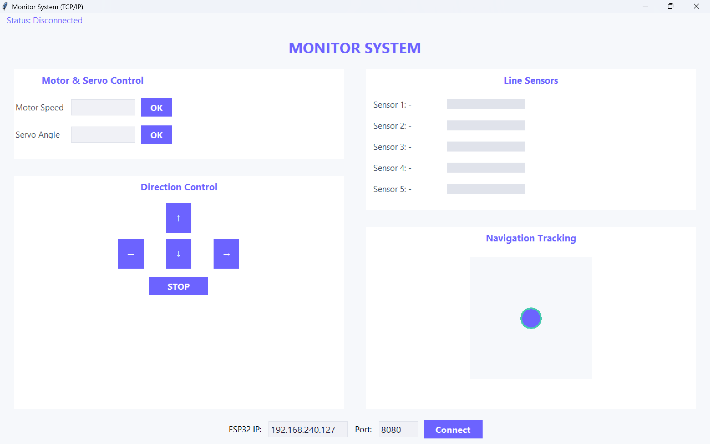

## How It Works

1. ESP32 starts as an AP with a configuration portal (WiFiManager)
2. Connect your PC to the ESP32 network
3. The Python GUI connects to ESP32 via TCP/IP
4. Use the dashboard to:
   - Control motor speed with sliders
   - Steer with direction buttons
   - Rotate the servo
   - View real-time line sensor status

## GUI



## Run

```bash
python src/main.py
```

## Team

- Moh. Abdul Hikmal (4222401032)
- Ichsan Fajar Yudika (4222401042)
- Wildan Mahfudh Khoirul Murtadho (4222401046)
- M. Rasyid Prasetyo (4222411048)
